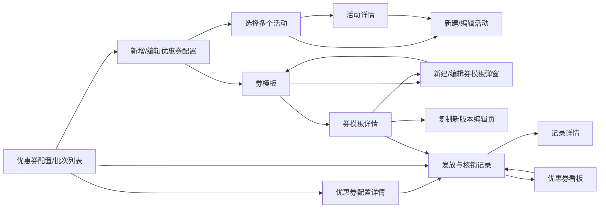

# 一期优惠券中心后台原型 · 页面评审清单

## 评审目标

本原型用于验证用户确认的后台页面结构和专项 A 优惠券基础能力的管理端表达。页面只服务俱乐部管理员，顾客端闭环作为后续页面，不放入本轮后台导航。

## 功能目录

| 二级模块 | 页面覆盖 |
|---|---|
| 活动管理中心 | 活动列表、新建/编辑活动、活动详情；只维护场景、时间和触发，不直接配置券 |
| 优惠券中心 | 二级入口“优惠券列表、优惠券管理”；优惠券列表覆盖配置/批次、新增/编辑和详情，优惠券管理只保留券模板 |
| 数据与记录 | 优惠券看板、发放与核销记录、只读记录详情 |

## 页面清单

| ID | 页面/场景 | 来源 | 本轮结论 |
|---|---|---|---|
| P01 | 活动列表 | 用户明确结构 | 已确认 |
| P02 | 新建/编辑活动 | 用户明确结构及活动规则 | 已确认 |
| P03 | 活动详情 | 用户明确结构 | 已确认 |
| P04 | 券模板 | 用户明确结构 | 已确认 |
| P05 | 新建/编辑券模板弹窗 | 用户明确结构及规则确认表；从券模板列表内完成 | 已确认 |
| P06 | 券模板详情 | 用户明确结构 | 已确认 |
| P10 | 优惠券配置/批次列表 | 用户要求采用现有后台列表形态；展示配置、关联对象和配置规模，不直接展示顾客券实例 | 已确认 |
| P11 | 新增/编辑优惠券配置页 | 用户明确“新增优惠券”与券模板为不同对象；可关联模板和多个活动并临时调整优惠规则 | 已确认 |
| P13 | 优惠券配置详情 | 展示模板、活动关系及顾客券实例入口；不进入发放规则层级 | 已确认 |
| P07 | 优惠券看板 | 用户明确结构及指标口径 | 已确认 |
| P08 | 发放与核销记录 | 用户明确结构及流水规则 | 已确认 |
| P09 | 记录详情/异常补偿抽屉 | 从“可查、可补发、待补偿”操作推断 | 后续取消；记录详情只读展示，不提供异常处置 |

## 页面关系

## 页面内关键交互

- 活动列表：状态筛选、场景筛选、关键词搜索、详情、编辑、复制、停用、删除草稿。
- 活动表单：先选择新客、充值常规或充值限时场景，配置时间和触发规则，保存草稿或发布；优惠券从详情/列表关联。
- 活动详情：查看活动规则快照、关联优惠券和记录；不提供活动数据看板。
- 券模板列表：计算方式、资格、场景标签筛选；通过列表工具栏新建券模板，查看、编辑未被引用模板、复制新版本。
- 券模板表单：新建/编辑默认以列表内弹窗呈现；预设填充三维规则，高级设置展开适用范围、有效期、使用方式；字段校验。复制新版本保留完整编辑页，便于核对原规则后再保存。
- 优惠券配置/批次列表：采用现有后台列表页形态，展示配置编号、关联券模板、活动、优惠规则、生效时间和配置规模；支持搜索和筛选，并可查看关联流水。
- 新增/编辑优惠券配置：从优惠券列表进入，选择已有券模板和多个活动；可临时调整优惠规则，保存后只生成配置/批次，不生成 CouponInstance。
- 券模板详情：展示不可变规则快照、引用活动、实例统计和版本复制入口。
- 看板：时间、活动、模板、发放来源筛选；展示触发量、到账实例、核销实例、核销率、核销次数和券均核销次数。
- 记录：保留发放、领取、核销三类流水切换；异常记录及其重试、补偿场景已从原型移除。

## 本轮保留的设计判断

- 活动是“何时、对谁、通过什么事件发券”；券模板是“如何计算优惠、什么条件可用”；优惠券是基于模板生成的可生效配置/批次，顾客券实例只在执行发放后生成。
- “满减”在界面上作为预设名称展示，真实字段仍为固定减免和使用门槛。
- 数据与记录放在同一一级模块，但看板和流水保持两张独立页面，避免混淆分析与追溯。
- “优惠券列表”与“优惠券管理”是优惠券中心下的并列二级入口；优惠券管理只提供券模板总览。发放规则页面及其关联流程不属于当前原型层级，活动详情只展示关联优惠券关系并提供跳转。
